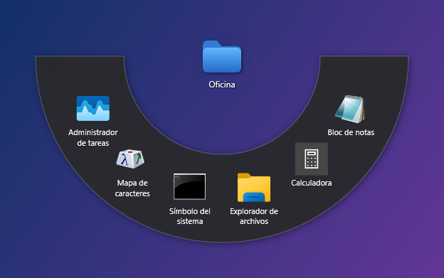
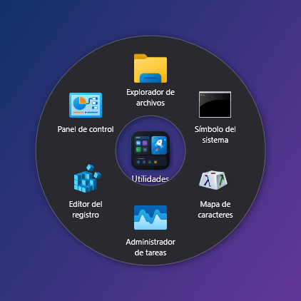
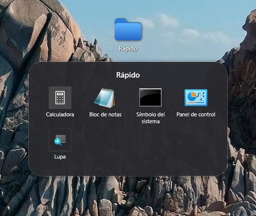
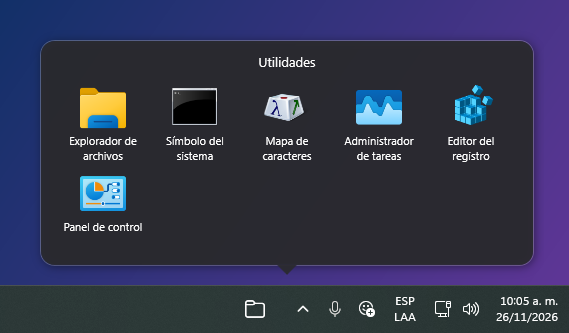
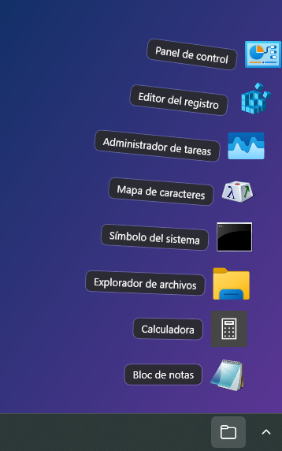
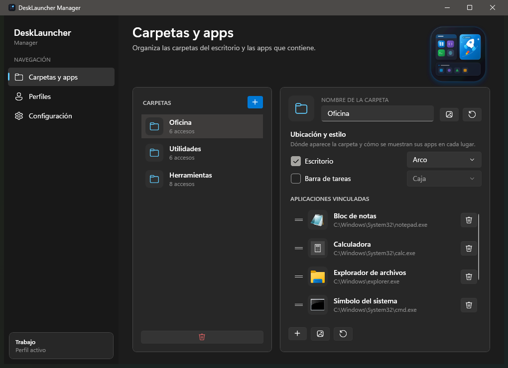
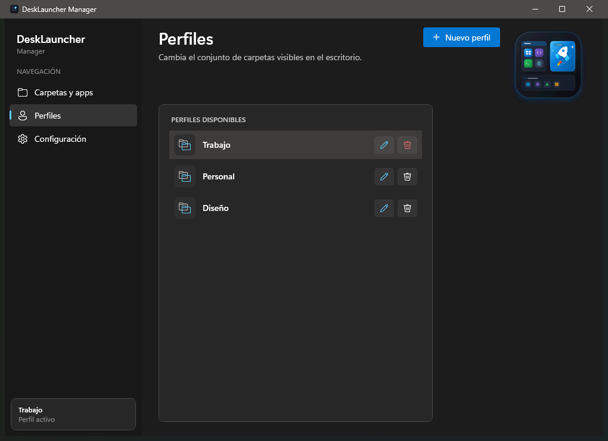
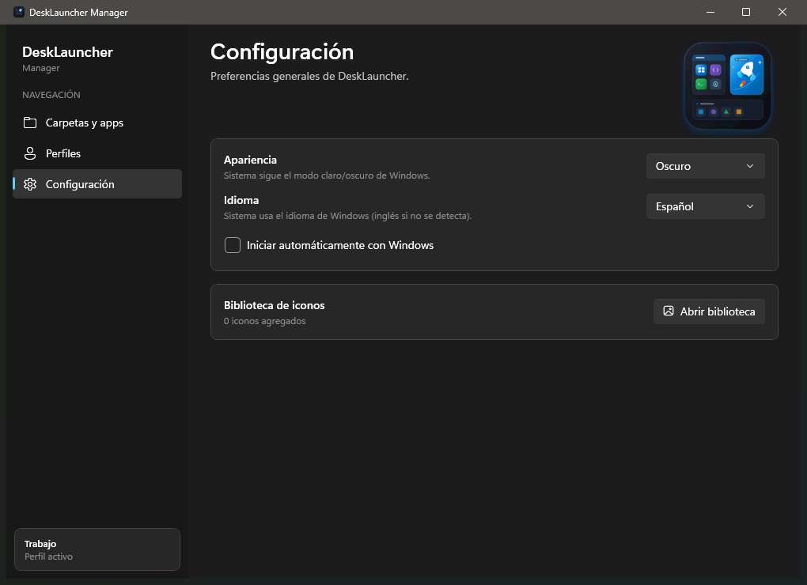
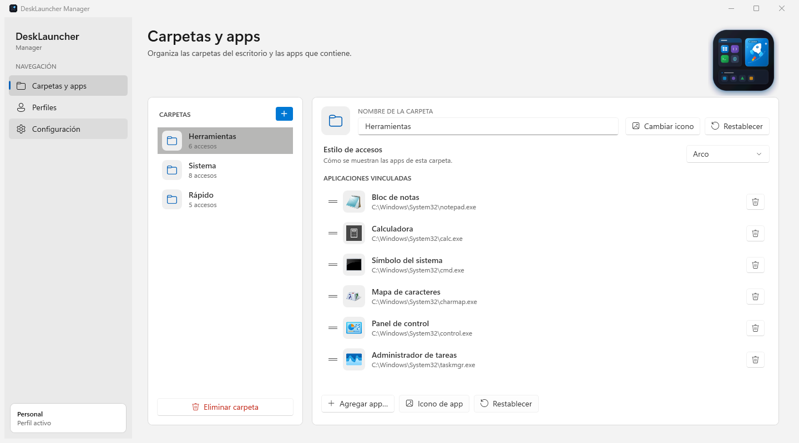
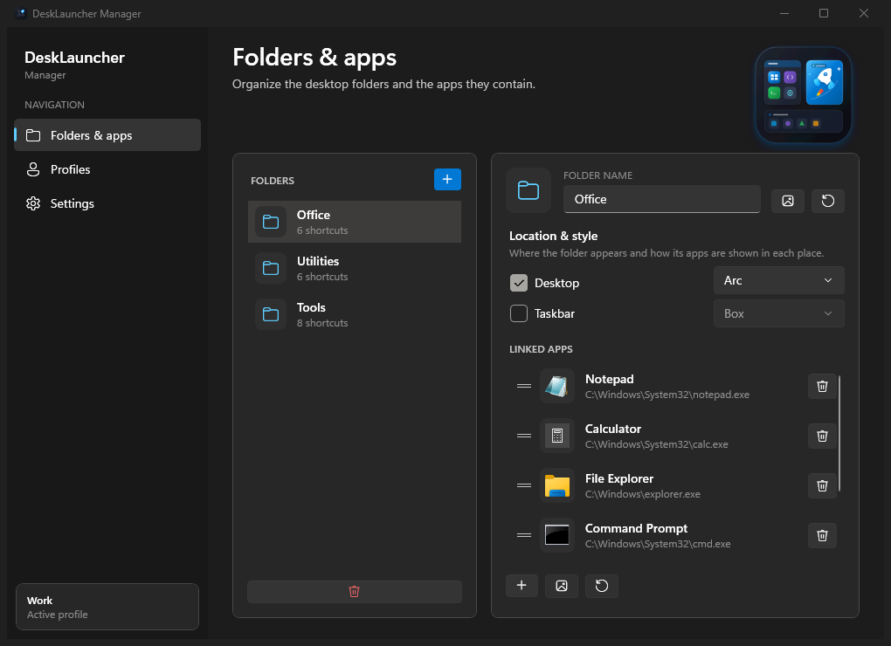

# DeskLauncher

Lanzador de accesos para el escritorio de Windows. Coloca carpetas flotantes sobre el escritorio; al hacer clic en una se despliegan sus apps con un estilo visual configurable (arco, anillo o app de teléfono). Se administra desde un Manager con tema Fluent claro/oscuro.

- Plataforma: Windows 10/11
- Stack: .NET 10, WPF (con Windows Forms para bandeja y pantallas)

## Descarga

Última versión: **[1.1.0](https://github.com/openwebdevelopers/desk-launcher-windows/releases/tag/v1.1.0)** (versión estable).

| Archivo | Descripción |
|---|---|
| [`DeskLauncher-1.1.0-win-x64.zip`](https://github.com/openwebdevelopers/desk-launcher-windows/releases/download/v1.1.0/DeskLauncher-1.1.0-win-x64.zip) | Recomendado. Un solo `.exe`, no requiere instalar nada: descomprime y ejecuta. |
| [`DeskLauncher-1.1.0-win-x64-requiere-dotnet10.zip`](https://github.com/openwebdevelopers/desk-launcher-windows/releases/download/v1.1.0/DeskLauncher-1.1.0-win-x64-requiere-dotnet10.zip) | Versión liviana (0,3 MB); requiere el [runtime .NET 10 Desktop](https://dotnet.microsoft.com/download/dotnet/10.0). |

Windows 10/11 de 64 bits. El ejecutable no está firmado, por lo que SmartScreen puede mostrar una advertencia. Todas las versiones están en [Releases](https://github.com/openwebdevelopers/desk-launcher-windows/releases).

## Capturas

### Launchers en el escritorio

Cada carpeta tiene su propio estilo de accesos.

| Arco | Anillo | Phone App |
|---|---|---|
|  |  |  |

### Barra de tareas

Las carpetas también pueden vivir en la barra de tareas, con estilo *Caja* o *Lista*.

| Caja | Lista |
|---|---|
|  |  |

### Manager



| Perfiles (renombrar y eliminar) | Configuración (tema e idioma) |
|---|---|
|  |  |

| Tema claro | Idioma inglés |
|---|---|
|  |  |

Las capturas usan una configuración de demostración (carpetas y apps genéricas de Windows), ver [Capturas de pantalla](#capturas-de-pantalla-1).

## Funciones

- **Carpetas en el escritorio**: se arrastran para moverlas, recuerdan su posición por monitor y se ubican justo encima del escritorio, por debajo de las ventanas normales.
- **Arrastrar y soltar**: suelta `.exe`, `.lnk` o carpetas sobre el icono de una carpeta para agregarlos.
- **Estilos de accesos por carpeta** (clic derecho en la carpeta > *Estilo de accesos*, o desde el Manager):
  - **Arco**: banda en arco alrededor del icono.
  - **Anillo**: círculo completo con el logo del launcher al centro. Si el icono está cerca de un borde de pantalla, el anillo se desplaza para entrar completo.
  - **Phone App**: rectángulo de esquinas redondeadas con cuadrícula de apps (usa `MaxGridColumns` del perfil).
- **Ubicación por carpeta**: cada carpeta puede mostrarse en el **Escritorio**, en la **Barra de tareas** o en ambos lugares, con un estilo independiente para cada uno (Manager > carpeta > *Ubicación y estilo*).
  - Estilos de la barra de tareas: **Caja** (cuadrícula de apps con una flecha hacia el icono) y **Lista** (filas con etiqueta que suben en curva desde el icono).
  - Los iconos de la barra de tareas se colocan sobre la barra, **después de las apps** por defecto. En *Configuración > Ubicación en la barra de tareas* (con un esquema de cada opción) puedes elegir entre después de las apps o junto a la bandeja. Windows no permite agregar elementos a la barra de tareas.
  - Con una app en pantalla completa (video, juego, presentación) los iconos se ocultan solos y vuelven al salir.
- **Alineación al escritorio**: las carpetas del escritorio se ajustan a la cuadrícula real de iconos de Windows y, al arrastrar, se ve una sombra con la posición de destino.
- **Animaciones**: zoom suave de los iconos al abrir el panel y aumento suave al pasar el mouse.
- **Perfiles**: conjuntos independientes de carpetas; se cambian desde el Manager o el menú de la bandeja, y se pueden renombrar y eliminar (siempre queda al menos uno).
- **Iconos personalizados**: cada carpeta y cada app puede usar un icono propio, elegido de una biblioteca central de iconos (agregar y quitar desde *Configuración*, o desde el modal que abre *Cambiar icono*). Acepta `.png .jpg .jpeg .bmp .ico .gif` y extrae iconos de `.exe .dll .lnk`.
- **Orden de apps**: se reordenan arrastrando el asa de cada fila; el cambio se ve al instante en el listado.
- **Tema**: Sistema (sigue el modo de Windows en vivo), Claro u Oscuro. Aplica también al menú de la bandeja.
- **Idioma**: inglés y español. Por defecto sigue el idioma de Windows (inglés si no se detecta); se cambia en *Configuración* sin reiniciar.
- **Bandeja del sistema**: abrir Manager (con pantalla de carga de 1,5 s), nueva carpeta, cambio de perfil y salir.
- **Iniciar con Windows**: opción en *Configuración*.
- **Instancia única**: abrir el ejecutable otra vez no crea una segunda copia.

## Requisitos

- Windows 10/11
- [.NET 10 SDK](https://dotnet.microsoft.com/download) (para compilar)

## Compilar y ejecutar

```powershell
cd DeskLauncher
dotnet build
.\bin\Debug\net10.0-windows\DeskLauncher.exe
```

## Opciones de arranque

- `--manager`: abre el Manager al terminar la pantalla de carga.
- Variable de entorno `DESKLAUNCHER_DATA`: usa otra carpeta de datos en lugar de `%APPDATA%\DeskLauncher\` (útil para demos, pruebas y capturas).
- Variable de entorno `DESKLAUNCHER_OPEN`: nombre de una carpeta del escritorio cuyo panel se abre solo 2 s después de iniciar (útil para capturas).

## Capturas de pantalla

Para regenerar las capturas sin tocar tus datos:

1. Crea una carpeta con un `global.json` y un `profiles\<id>\config.json` de demostración (carpetas con estilos `Arc`, `Ring` y `Phone`, y `CollapseOnMouseLeave` en `false`).
2. Cierra DeskLauncher y ejecútalo con `DESKLAUNCHER_DATA` apuntando a esa carpeta (más `--manager` para el Manager, o `DESKLAUNCHER_OPEN=<carpeta>` para abrir un panel).
3. Captura las ventanas y guarda los PNG en `docs/screenshots/`.

## Datos de usuario

Se guardan en `%APPDATA%\DeskLauncher\`:

| Ruta | Contenido |
|---|---|
| `global.json` | Perfiles, perfil activo, tema, idioma, iniciar con Windows |
| `profiles\<id>\config.json` | Carpetas, apps, posición, estilo e iconos de cada perfil |
| `icons\` | Biblioteca de iconos personalizados (PNG) |
| `iconcache\` | Caché de iconos extraídos del sistema |

Las escrituras son atómicas y dejan un respaldo `.bak` que se usa si el archivo principal se corrompe.

## Estructura del proyecto

```
DeskLauncher/
  App.xaml(.cs)            Arranque, instancia única, bandeja, carpetas del escritorio
  AppState.cs              Estado global y operaciones (carpetas, apps, iconos, estilo, perfiles)
  Models.cs                Configuración: perfil, carpeta, acceso, estilos
  ConfigStore.cs           Persistencia JSON con respaldo
  Services.cs              Anclaje al escritorio, monitores, lanzamiento, inicio con Windows
  NativeMethods.cs         P/Invoke de Win32
  DockWindow.xaml(.cs)     Icono flotante de cada carpeta
  ExpandedPanelWindow.cs   Panel desplegable (Arco, Anillo, Phone App) y animaciones
  ManagerWindow.xaml(.cs)  Manager: carpetas/apps, perfiles, configuración
  IconManager.cs           Módulo central de iconos (consulta, importación, biblioteca)
  IconLibraryView.*        Cuadrícula de la biblioteca de iconos
  IconPickerWindow.*       Modal para elegir o administrar iconos
  Loc.cs                   Textos en inglés y español, detección del idioma
  ThemeService.cs          Tema claro/oscuro/sistema
  TrayMenuTheme.cs         Tema del menú de la bandeja
  SplashWindow.*           Pantalla de carga
  Assets/                  logo.png (principal), appicon.png/.ico (ventanas y sistema)
```

## Iconos de la app

- `Assets\logo.png`: icono principal (cohete). Pantalla de carga, esquina superior derecha de la app y centro del estilo Anillo.
- `Assets\appicon.png` / `appicon.ico`: icono secundario. Ventanas, bandeja del sistema y ejecutable.
